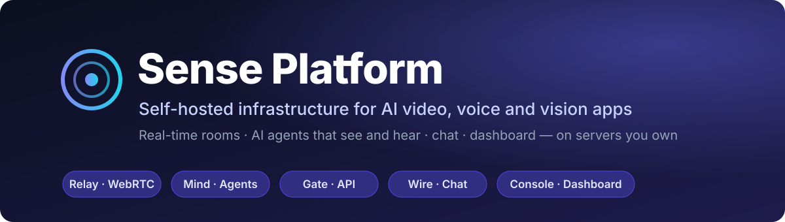
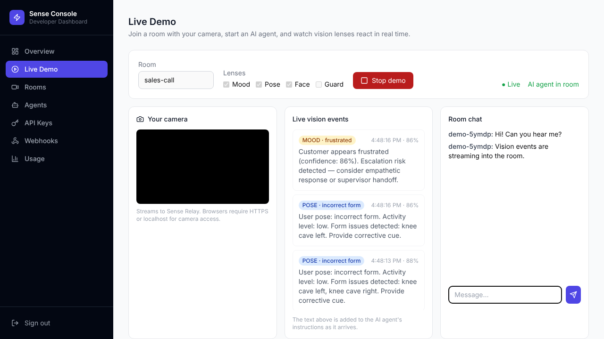
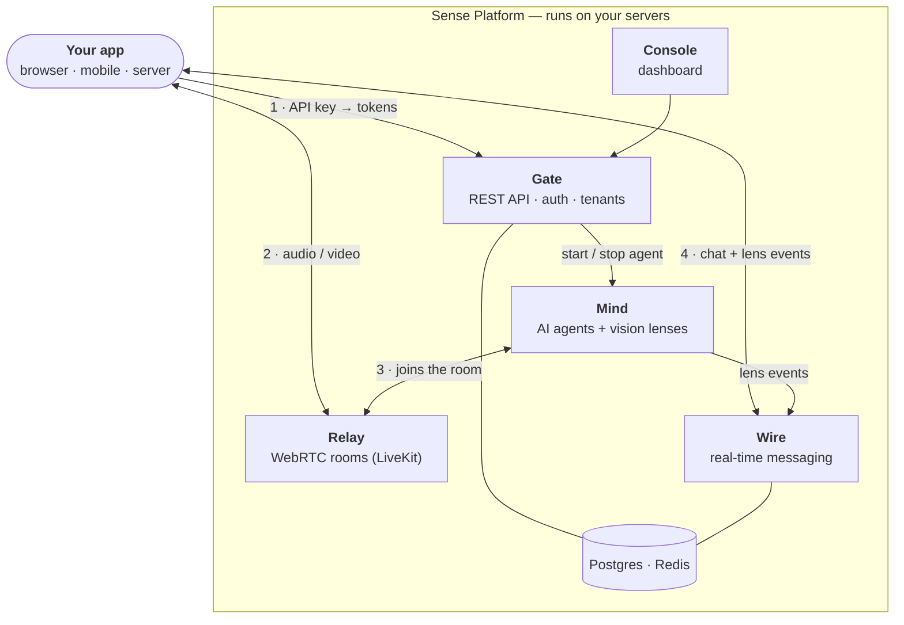

<div align="center">



<br/>

[](https://github.com/VenkataAnilKumar/SensePlatform/actions/workflows/ci.yml)
[](LICENSE)
[](docker-compose.yml)
[](sdks/sense-py)
[](sdks/sense-js)

**[Quick start](#-quick-start)** · **[Live demo](#-live-demo)** · **[How it works](#-how-it-works)** · **[Build with it](#-build-with-it)** · **[Examples](#-examples)** · **[Docs](#-documentation)**

</div>

<br/>

Sense Platform lets you build apps where an **AI agent joins a live video call, sees and hears the participants, and reacts in real time** — without sending your media or data to a third-party cloud. It is a self-hosted alternative to GetStream, built for AI-first products and started with one `docker compose up`.

<table>
<tr>
<td align="center" width="20%"><h3>5</h3>services</td>
<td align="center" width="20%"><h3>4</h3>vision lenses</td>
<td align="center" width="20%"><h3>23</h3>provider plugins (LLM · STT · TTS · vision)</td>
<td align="center" width="20%"><h3>2</h3>SDKs (Python, TypeScript)</td>
<td align="center" width="20%"><h3>5</h3>example products</td>
</tr>
</table>

## ✨ Why Sense

|  | Cloud video/chat vendors | **Sense Platform** |
|--|--|--|
| **Where media and data live** | Vendor's cloud | **Your servers** |
| **Pricing** | Per seat / per minute | **None — you run it** |
| **AI** | Add-ons you wire up yourself | **Agents and vision lenses built in** |
| **Providers** | Vendor's choice | **Pick any LLM, STT and TTS** (Anthropic, OpenAI, Gemini, Deepgram, ElevenLabs, …) |
| **License** | Proprietary | **Apache 2.0** |

---

## 🚀 Quick Start

> **You need:** Docker with Compose, and an Anthropic API key for the agent's LLM. Voice also needs Deepgram (speech-to-text) and ElevenLabs (text-to-speech) keys; the vision features work without them.

**1 · Configure**

```bash
git clone https://github.com/VenkataAnilKumar/SensePlatform
cd SensePlatform
cp .env.example .env        # then add ANTHROPIC_API_KEY (and optionally DEEPGRAM_API_KEY, ELEVENLABS_API_KEY)
```

**2 · Start everything**

```bash
docker compose up --build
```

The first build takes several minutes (the agent image includes PyTorch for the vision lenses). When it settles, open the **Console at <http://localhost:4000>**.

<details>
<summary>All service URLs</summary>

| URL | Service |
|-----|---------|
| http://localhost:4000 | **Console** — developer dashboard and Live Demo |
| http://localhost:3000 | **Gate** — REST API (`/docs` for OpenAPI) |
| ws://localhost:3001 | **Wire** — real-time messaging |
| http://localhost:8080 | **Mind** — agent control |
| ws://localhost:7880 | **Relay** — WebRTC |

</details>

**3 · Create a tenant and API key**

```bash
curl -s -X POST http://localhost:3000/tenants \
  -H "Content-Type: application/json" \
  -d '{"name": "Acme", "slug": "acme", "email": "dev@acme.com"}'
```

Copy `api_key` from the response — **it is shown once** (only a hash is stored) — and sign in to the Console with it.

**4 · Start an agent**

```bash
curl -s -X POST http://localhost:3000/agents/start \
  -H "X-API-Key: sk_live_your_key" -H "Content-Type: application/json" \
  -d '{"room_id": "demo", "lenses": ["MoodLens"], "instructions": "You are a helpful assistant."}'
```

> **Going to production?** Set `SENSE_ENV=production`. The services then refuse to start with default secrets, and `POST /tenants` requires an `X-Admin-Key` header. See the [self-hosting guide](docs/self-hosting.md) for TLS, ports, backups and a checklist.

---

## 🎥 Live Demo

Open **Live Demo** in the Console (`/demo`). Pick a room and the lenses to run, press **Start demo**, and allow the camera. Within seconds you will see:

- your camera streaming into a **WebRTC room**,
- an **AI agent** that has joined that room on the server,
- **vision events** arriving live, each with the sentence that is added to the agent's instructions,
- a **real-time chat** panel for the room.

<div align="center">



<sub>The Live Demo page. Events above came from a still test photo fed in as the camera; the camera preview is blacked out in this screenshot.</sub>

</div>

Prefer a terminal? `python demo.py` runs a scripted walkthrough (and falls back to simulated output when no services are running). Presenting to a customer? See the [demo script](docs/demo-script.md).

---

## 🧭 How it works



1. Your backend asks **Gate** (with an API key) to start an agent and to mint a join token.
2. The user's browser joins a **Relay** room with that token and publishes camera and microphone.
3. **Mind** runs one agent per room. It joins the same room, and each **lens** analyses sampled video frames with YOLO.
4. Every lens observation is added to the agent's LLM instructions *and* pushed through **Wire** to your frontend, so your UI can show it too.

### Vision lenses

| Lens | What it reports | Default throttle |
|------|-----------------|:----:|
| **MoodLens** | A mood estimate from body pose — neutral · satisfied · confused · frustrated *(heuristic, not a facial-emotion model)* | 3 s |
| **PoseLens** | Body keypoints — posture and form faults | 2 s |
| **GuardLens** | Weapon-like objects (knife, scissors, gun, bat); violations bypass the throttle | 2 s |
| **FaceLens** | Face count, occupancy, no-face and multiple-face alerts | 5 s |

Lens settings can be changed at runtime, per room, without restarting the agent. YOLO weights are not shipped — Ultralytics downloads them on first use.

---

## 🛠 Build with it

<details open>
<summary><b>Python SDK</b></summary>

```bash
pip install ./sdks/sense-py      # from this repository
```

```python
import asyncio
from sense import SenseClient, SenseWire, LensStream

async def main():
    async with SenseClient(api_key="sk_live_...") as client:
        await client.connect()
        await client.agents.start("demo", lenses=["MoodLens"])      # launch an agent

        async with SenseWire(client, "messaging", "demo") as wire:   # real-time chat
            stream = LensStream(wire)                                # live vision events

            @stream.on_mood
            def on_mood(event):
                print(f"[{event.mood}] {event.context_text}")

            wire.on_message(lambda msg: print(f"{msg.user_id}: {msg.text}"))
            await wire.send("Hello from Python!")
            await wire.wait()

asyncio.run(main())
```

</details>

<details>
<summary><b>TypeScript / JavaScript SDK</b></summary>

```bash
# packages live in sdks/sense-js (build from source)
cd sdks/sense-js && npm install
```

```typescript
import { SenseClient } from "@sense/core";
import { SenseRoom }   from "@sense/vision";
import { Channel }     from "@sense/chat";
import { LensStream }  from "@sense/lens";

const client = new SenseClient({ apiKey: "sk_live_..." });
await client.connect();

const room = new SenseRoom(client);                                // WebRTC room
await room.join({ roomId: "demo", autoPublish: true });            // publishes webcam + mic

const channel = new Channel(client.wire, "messaging", "demo");     // chat
await channel.sendMessage("Hello from the browser!");

const lenses = new LensStream(client.wire, "demo");                // live vision events
lenses.onMood((e) => console.log(`${e.mood} — ${e.contextText}`));
```

</details>

<details>
<summary><b>Custom agents with the Sense Mind SDK</b></summary>

```python
from sense_mind import SenseMind, SenseRunner
from sense_mind.plugins import anthropic, deepgram, elevenlabs
from sense_mind.lenses import MoodLens, PoseLens

agent = SenseMind(
    instructions="You are a supportive agent. If the customer is frustrated, acknowledge it first.",
    llm=anthropic.LLM("claude-sonnet-4-6"),
    stt=deepgram.STT(),
    tts=elevenlabs.TTS(),
    lenses=[MoodLens(throttle_seconds=3), PoseLens()],
)

SenseRunner(agent, room="support-room-1").serve()
```

| Category | Plugins |
|----------|---------|
| **LLM** | `anthropic` · `openai` · `gemini` · `mistral` · `openrouter` · `xai` |
| **STT** | `deepgram` · `assemblyai` · `fast_whisper` |
| **TTS** | `elevenlabs` · `cartesia` · `kokoro` · `fish` · `pocket` |
| **Vision** | `ultralytics` (YOLO) · `moondream` · `roboflow` · `nvidia` |

</details>

<details>
<summary><b>Multi-agent control API (Mind, port 8080)</b></summary>

Mind runs one agent per room and exposes a small REST API:

```bash
curl -X POST localhost:8080/agents/start -H "Content-Type: application/json" \
  -d '{"room": "acme__room-1", "lenses": ["MoodLens"], "llm": "claude-sonnet-4-6"}'

curl localhost:8080/agents/status

curl -X POST localhost:8080/agents/acme__room-1/lenses/mood_lens/configure \
  -H "Content-Type: application/json" -d '{"throttle_seconds": 5.0, "enabled": true}'

curl -X POST localhost:8080/agents/stop -H "Content-Type: application/json" \
  -d '{"room": "acme__room-1"}'
```

In normal use you call these through **Gate**, which namespaces rooms per tenant.

</details>

---

## 📦 Examples

Five example agents in [`examples/`](examples/):

| Example | Lenses | What it does |
|---------|--------|--------------|
| [**contact-center**](examples/contact-center/agent.py) | Mood · Face | Adapts tone to frustration; escalates to a human on trigger |
| [**sales-coach**](examples/sales-coach/agent.py) | Mood · Pose | Silent whisper coach — spots buying signals, flags objections |
| [**fitness-coach**](examples/fitness-coach/agent.py) | Pose · Face | Real-time form cues, rep counting, rest detection |
| [**telehealth**](examples/telehealth/agent.py) | Face · Pose · Mood | Clinical assistant — logs observations, flags distress |
| [**security-soc**](examples/security-soc/agent.py) | Face · Guard | Zone monitoring, threat detection, auto-incident |

```bash
ANTHROPIC_API_KEY=sk-ant-... SENSE_ROOM=support python examples/contact-center/agent.py
```

---

## 📖 Documentation

| | |
|--|--|
| [**Quick start**](docs/quickstart.md) | Up and running in five minutes |
| [**Self-hosting guide**](docs/self-hosting.md) | TLS, ports, backups, scaling, production checklist |
| [**Demo script**](docs/demo-script.md) | A 15-minute customer walkthrough of what is verified |
| [**Architecture & review**](docs/architecture.md) | Data flow, resolved issues, known limitations |
| [**Python SDK**](sdks/sense-py/README.md) | `SenseClient`, `SenseWire`, `LensStream` |

---

## ✅ Project status

Continuous integration runs the test suites for Mind, Gate and Wire, builds the Console, and runs a **`docker compose` smoke test** that builds every image and exercises the API on each change.

**Verified working** — Postgres, Redis, Relay, Gate, Wire and Mind running together: tenant and API-key flow, tokens, room joins, agent start/stop, real-time chat with threads and history, and the full vision path (video published to a room → YOLO lens → Wire → browser) for the Mood, Pose and Face lenses. The Console and its Live Demo page work against a live stack.

**Known limitations**

- The spoken conversation loop (speech-to-text → LLM → text-to-speech) has not yet been exercised with real provider keys.
- Agents publish audio only — not video — into rooms.
- Mood detection is a pose heuristic: treat it as a prototype signal, not an emotion classifier.
- The Python SDK's `channels.*` REST helpers don't match Wire's routes; use `SenseWire` for chat.

<details>
<summary>Build history</summary>

| | Phase | What shipped |
|-|-------|--------------|
| ✅ | 1 · Core | Relay · Mind · vision lenses · Docker Compose |
| ✅ | 2 · Gate | FastAPI gateway · JWT auth · multi-tenancy · webhooks · usage metering |
| ✅ | 3 · Wire | WebSocket messaging · Postgres persistence · Redis pub/sub fan-out |
| ✅ | 4 · JS SDK | `@sense/core` · `@sense/vision` · `@sense/chat` · `@sense/lens` |
| ✅ | 5 · Console | Next.js dashboard — rooms, agents, keys, webhooks, usage, Live Demo |
| ✅ | 6 · Agent pool | Multi-agent pool · vision event stream · `/agents` API |
| ✅ | 7 · Python SDK + docs | `sense-platform` SDK · quickstart · architecture · self-hosting |
| ✅ | 8 · Examples | Contact center · sales coach · fitness coach · telehealth · security SOC |

</details>

---

<div align="center">

**[Apache 2.0](LICENSE)** · Built with [LiveKit](https://livekit.io), [FastAPI](https://fastapi.tiangolo.com), [Next.js](https://nextjs.org), [Ultralytics YOLO](https://ultralytics.com) and [Claude](https://anthropic.com)

Issues and pull requests are welcome.

</div>
